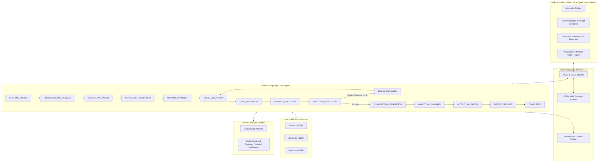

# Data Mind
### *Think Data. Discover Intelligence.*

> **Autonomous AI Data Analyst & Coding Agent | Windows Desktop Application | Local Open-Source LLMs**

Data Mind is an autonomous desktop data-analysis workstation that understands natural-language analytical objectives, deterministically profiles datasets, formulates statistical execution plans, synthesizes Python code, validates code with AST security guardrails, executes securely inside an isolated sandbox, autonomously detects and corrects execution failures, generates interactive Plotly visualizations, and compiles evidence-grounded mathematical reports.

Built with **Google-inspired minimalism** — prioritizing intelligence, simplicity, restrained motion, and generous whitespace over flashy decorations.

---

## 1. Key Capabilities

- **Autonomous Analytical Workflows**: Describe a business problem or data question in natural language; Data Mind autonomously figures out the data cleaning, transformations, statistical calculations, and visualizations.
- **100% Local Inference First**: Native support for **Ollama**, **LM Studio**, **llama.cpp**, and generic OpenAI-compatible local servers without requiring paid AI API subscriptions.
- **15-Node LangGraph Agent**: Independent graph nodes managing state transitions, planning, code generation, execution, evaluation, and self-correction.
- **Autonomous 3-Retry Self-Correction**: When syntax errors, missing columns, or runtime exceptions occur, Data Mind captures the traceback, consults the dataset schema, refines the Python script, and re-executes.
- **Hardened Execution Sandbox**: Docker container execution (`read-only root`, `network: none`, unprivileged user, memory/CPU bounds) with AST static code guardrails blocking unauthorized OS/subprocess/socket operations.
- **Interactive Visualizations**: Serialized Plotly.js charts (Bar, Line, Scatter, Heatmap, Box, Distribution) with zoom, pan, hover, and JSON export.
- **Empirical Analytical Reports**: Markdown reports grounded strictly in computed mathematical metrics and stdout results without hallucinated statistics.
- **Full Windows Desktop Experience**: Responsive desktop layout supporting Light and Dark modes, persistent SQLite storage in `%APPDATA%\DataMind`, and one-click launch via `DataMind.bat`.

---

## 2. Architecture & Design Principles



### Visual Identity Tokens (Google-Inspired Minimalism)
- **Main Background**: `#FFFFFF` (Dark: `#202124`)
- **Secondary Surface**: `#F8F9FA` (Dark: `#292A2D`)
- **Subtle Surface**: `#F1F3F4` (Dark: `#303134`)
- **Primary Accent**: `#1A73E8`
- **Subtle Border**: `#DADCE0` (Dark: `#3C4043`)
- **Primary Text**: `#202124` (Dark: `#E8EAED`)
- **Muted Text**: `#5F6368` (Dark: `#9AA0A6`)
- **Restrained Accents**: Green (`#188038`), Amber (`#F29900`), Red (`#D93025`)
- **Corner Radii**: 6–8px (small controls), 8–10px (inputs), 10–12px (panels and dialogs)

---

## 3. Getting Started on Windows

### Prerequisites
- **Windows 10/11 x64**
- **Python 3.11** (located in `backend/.venv`)
- **Node.js 18+** & npm (for building the frontend)
- **Local LLM Server** (Optional: install [Ollama](https://ollama.com/) or [LM Studio](https://lmstudio.ai/))
- **Docker Desktop** (Optional for container isolation; fallback isolated process sandbox is built in)

### Launching the Application
Simply double-click:
```bat
DataMind.bat
```
This automatically launches the FastAPI backend on port 8000 and opens the desktop interface in a native, borderless application window with dimensions 1440 × 900.

### Creating Desktop and Start Menu Shortcuts
Run PowerShell as user:
```powershell
powershell -ExecutionPolicy Bypass -File installer\create_shortcuts.ps1
```

---

## 4. Running Tests

To verify that all unit, integration, and security guardrail tests pass:
```powershell
$env:PYTHONPATH = "backend"
backend\.venv\Scripts\pytest backend\tests -v
```

---

## 5. User Data & Storage Structure

All application data is isolated within the user's roaming AppData directory:
```
%APPDATA%\DataMind\
├── database/         # datamind.db (SQLite with WAL mode)
├── config/           # Provider configurations and preferences
├── datasets/         # Uploaded CSV, XLSX, JSON, Parquet, SQLite files
├── sessions/         # Session state and history
├── artifacts/
│   ├── charts/       # Serialized Plotly JSON files
│   ├── reports/      # Markdown and exported analytical reports
│   ├── code/         # Generated and edited Python scripts
│   └── exports/      # Exported artifacts
├── logs/             # Execution and server logs
└── cache/            # Temporary sandbox data
```

---

## 6. License
MIT License. Built for data analysts, researchers, and developers who value data privacy, analytical correctness, and refined desktop software engineering.

